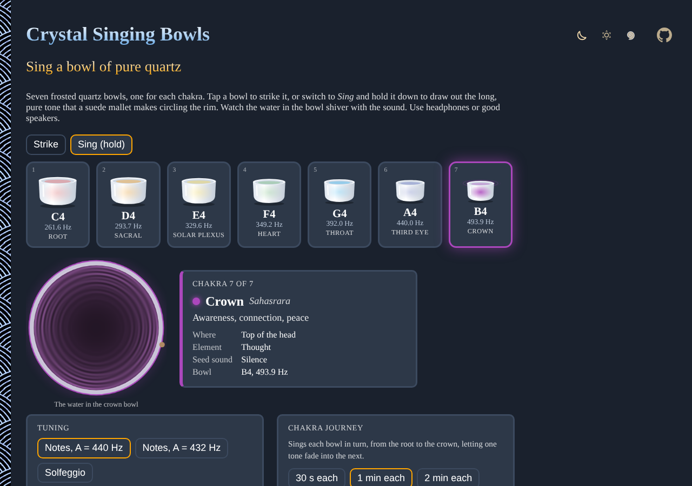

# Crystal-Singing-Bowls

Play a set of seven virtual quartz crystal singing bowls right in your browser. Strike a bowl, or hold it down to sing it like a suede mallet circling the rim, and watch the water in the bowl shiver with the sound. The bowls are synthesized live, so there are no audio files to load, and it works offline. Use headphones or good speakers.

- [Play the bowls](https://evoluteur.github.io/crystal-singing-bowls/)
- [About crystal bowls](https://evoluteur.github.io/crystal-singing-bowls/about.html)

## What it does

Seven frosted bowls, one for each chakra, from the red root bowl to the violet crown. Tap or click a bowl to strike it. Switch to **Sing** and hold a bowl down to make it swell and sustain, then let go to let it fade. The number keys 1 to 7 play the bowls from the keyboard, and you can play several at once.

- **Tuning**: the notes C to B with A at 440 Hz or 432 Hz, or the Solfeggio frequencies (396 to 963 Hz), in a low or middle octave.
- **Water view**: the bowl you last played, seen from above, with the standing ripples raised by its vibrating rim. A sung bowl's pattern turns with the mallet.
- **Chakra card**: the name, Sanskrit name, place, element and seed sound of the bowl's chakra.
- **Chakra journey**: sings each bowl in turn from root to crown, 30 seconds, 1 or 2 minutes each, fading one tone into the next.
- **Sound bath**: 5 to 30 minutes of soft strikes and long sung tones, with silence in between.

## About the sound

Fused quartz loses very little energy, so a crystal bowl rings with a nearly pure tone for a long time. Each bowl here is a fundamental made of two sine oscillators a fraction of a hertz apart (the slow pulse of a real, slightly out-of-round bowl), plus faint overtones at 2, 2.83 and 5.35 times the pitch. A sung bowl swells slowly, wavers as the mallet goes round, and adds a whisper of band-passed noise for the suede on the glass. The mix goes through a synthesized room reverb and a compressor.

This is a model of the sound and not a recording. The bowls are not meant as a medical treatment, and the chakra notes and colors are a modern convention.

## How it is built

The pages are plain HTML, CSS and JavaScript with the Web Audio API, with no dependencies and no build step. Just open `index.html`. It is also a small installable web app: add it to your home screen or desktop and it works offline.

- The bowls are drawn as SVG, the water on a canvas.
- The app logic is in [js/crystal.js](https://github.com/evoluteur/crystal-singing-bowls/blob/main/js/crystal.js).
- Three color themes (dark, light and blue) are shared with my other projects.
- Your tuning, volume and other settings are kept in the browser's local storage.

## Open Source

Crystal-Singing-Bowls is open source at [GitHub](https://github.com/evoluteur/crystal-singing-bowls) with MIT license.

Had fun browsing the app? [Buy me a coffee by becoming a sponsor](https://github.com/sponsors/evoluteur).

You may also be interested in my other sound projects [Tibetan-Singing-Bowls](https://github.com/evoluteur/tibetan-singing-bowls) ([demo](https://evoluteur.github.io/tibetan-singing-bowls/)), [Healing-Frequencies](https://github.com/evoluteur/healing-frequencies) ([demo](https://evoluteur.github.io/healing-frequencies/)) and [Cymatics](https://github.com/evoluteur/cymatics) ([demo](https://evoluteur.github.io/cymatics/)). For more mystic arts as small web apps, see [Esoterica](https://evoluteur.github.io/esoterica.html).

Copyright (c) 2026 [Olivier Giulieri](https://evoluteur.github.io/).
